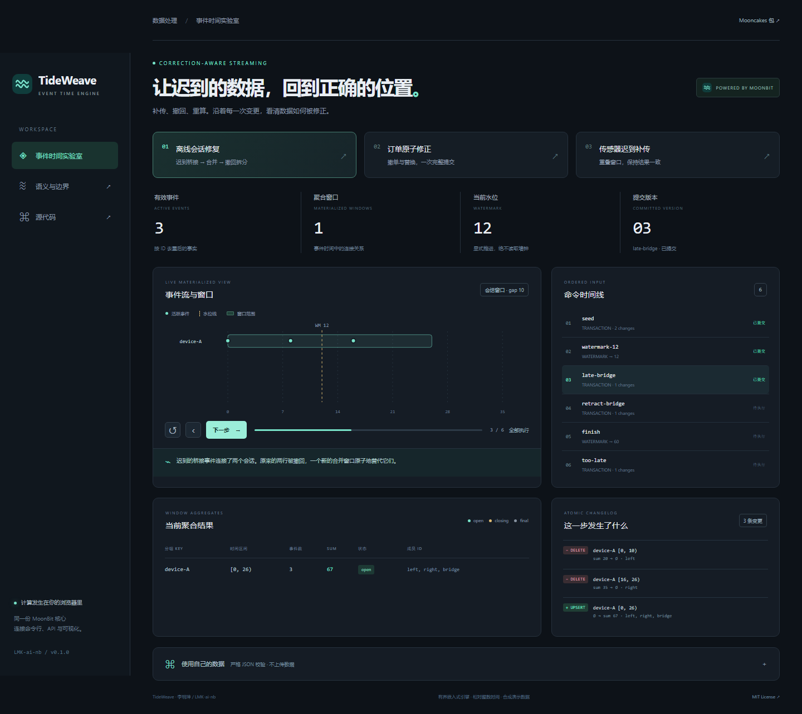

# TideWeave

**让迟到与撤回的数据得到完整、一致、可解释的修正。**

MoonBit 事件时间窗口与修正日志引擎。迟到事件可以合并会话，撤回桥接事件可以重新拆分会话；每次原子修正输出 before/after 变更，显式水位线保护已终结事实，下游按版本检查漏接与旧值冲突。

[在线实验室](https://lmk-ai-nb.github.io/TideWeave/) · [Mooncakes](https://mooncakes.io/docs/LMK-ai-nb/tideweave) · [English](README.en.md) · [语义契约](docs/SEMANTICS.md) · [自检证据](docs/ACCEPTANCE.md)




## 一个容易出错的真实问题

同一设备先上报 at=0 和 at=16 的两条记录，gap=10，因此它们属于两个会话。设备恢复网络后补传 at=8 的记录，两个会话应合并。随后发现该记录有误并撤回，窗口必须再次拆分。只对 SUM 做加减会留下错误的边界、成员与 min/max。

TideWeave 将每次修正视为原子状态变更：计算候选事实 → 重建受影响 key → 校验终结约束 → 提交版本 → 输出完整变更。事务若失败，窗口、事件索引、去重状态与版本一起保持原状。

## 已实现

- 滚动、带相位偏移的滑动与会话窗口；半开区间；负窗口起点的数学 floor 对齐。
- 按事件 ID 插入、替换、撤回，支持跨 key 移动与多项原子事务。
- 会话迟到合并、撤回拆分，count / Int64 sum / min / max 与完整成员来源。
- open → closing → final；保护已终结窗口及原始事件，拒绝将旧事实重新打开。
- 成功命令幂等、冲突检测；可重放检查点恢复后继续去重。
- 稳定顺序的 before/after 日志，以及校验版本连续性、旧值与原子应用的下游 `View`。
- 严格 JSON 协议，拒绝重复解码键、未知字段、被浮点舍入掩盖的小数和不适用参数。
- Node CLI、三个可重现用例、交互式浏览器实验室，共用 MoonBit 核心。

## 在 MoonBit 中使用

要求编译器 **0.10.16 或更新兼容版本**。

```sh
moon add LMK-ai-nb/tideweave@0.1.0
```

在消费项目的 `moon.pkg` 加入：

```moonbit
import { "LMK-ai-nb/tideweave" @tide }
```

在可抛出错误的函数中：

```moonbit
let cfg = @tide.config(@tide.Session(gap=10), lateness=20)
let engine = @tide.Engine::new(cfg)
let view = @tide.View::new()
let outcome = engine.apply(@tide.Transact(id="batch-1", changes=[
  @tide.Put({ id: "left", key: "device-A", at: 0, value: 20 }),
  @tide.Put({ id: "right", key: "device-A", at: 16, value: 35 }),
]))
view.apply(outcome)
let restored = @tide.restore(engine.checkpoint())
assert_true(restored.rows() == engine.rows())
```

完整公开接口由 `moon info` 生成，见 [pkg.generated.mbti](pkg.generated.mbti)。`aggregate` 可批处理；`Engine` 可持续接收容量内的修正；`replay_json` / `resume_json` 提供严格文本边界。

## 运行与验证

```sh
moon version --all
moon check --target all --deny-warn
moon test --target all --deny-warn
moon build --target all --deny-warn
moon fmt --check
moon info
moon run cmd/demo
node scripts/build.mjs
node --test tests/cli.test.mjs
node scripts/serve.mjs
```

浏览器打开 `http://127.0.0.1:4174`。Node 要求 22+；没有第三方 npm 依赖。native 构建还需要平台 C 工具链，Windows CI 使用 MSVC。

```sh
node bin/tideweave.mjs run examples/order-amendment.json --checkpoint checkpoint.json
node bin/tideweave.mjs run examples/session-correction.json
node scripts/benchmark.mjs
```

CLI 退出码：0 表示所有命令 accepted/duplicate；1 表示存在 rejected/conflict（演示中有意触发）；2 表示输入／IO／运行错误。恢复时传入 `{schema_version:1,checkpoint:<保存的对象>,commands:[...]}` 并使用 `resume` 子命令。完整格式见 [FORMAT.md](docs/FORMAT.md)。

可选浏览器检查：安装 Python Playwright 和 Chromium 后，在预览服务运行时执行 `python tests/browser.py`。CI 在 Linux 实际运行此检查。

## 质量与边界

37 个 MoonBit 测试包括独立区间枚举 oracle、独立图连通 oracle、混合 key 状态差分、原子回滚、终结保护和检查点恢复。8 个 Node 集成测试覆盖公共协议与真实 CLI；Chromium 检查交互、导出、注入文本与 390px 手机布局。GitHub CI 在 Linux、macOS、Windows 检查 wasm、wasm-gc、js、native 四个目标。

这是**有界、同步、单进程**的可嵌入状态机，适用于离线对账、边缘批次及流处理回归测试。最多 5000 活跃事件、10000 成功命令、20000 窗口、2 Mi 规范 journal 单元；不自动遗忘去重或终结事实。连续无限流需要宿主设计分区／批次生命周期，宿主还负责消息 IO、持久化、授权与外部消费一致性。这里不提供分布式运行时或外部 exactly-once 承诺。

Windows / Node 24 合成基准：4096 事件、64 key、32 批次，包含解析、状态修正、日志、检查点和完整 JSON 输出，10 次样本中位约 84 ms。环境、范围与复现命令见 [BENCHMARK.md](docs/BENCHMARK.md)，不将其外推为生产吞吐承诺。

## 原创性与申报

维护者：李明坤 / `LMK-ai-nb`。独立新仓库与新业务实现，不复用 submit-guard、permscope 或 AgentCanary 的核心。事件时间、窗口和 changelog 是已有概念；本项目的独立贡献是修正、会话拆分、事务终结保护、下游旧值校验和重启去重的组合实现，不声称发明流处理。

开发使用 AI 辅助；维护者须理解实现并承担验证责任。原创代码 MIT，标准库编译分发保留许可与 NOTICE，所有示例为合成数据，见 [第三方说明](THIRD_PARTY_NOTICES.md)。

十月报名表要求一页内 Markdown 申报书，且注明“不要使用 AI 编写”。项目事实文档是参考材料，正式申报书须由李明坤理解项目后亲自撰写。技术交付不等于完成官方报名／通过审核。见 [申报说明](docs/SUBMISSION.md) 与 [三分钟演示](docs/DEMO.md)。

