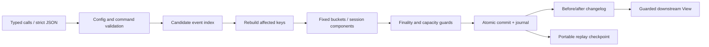

# Architecture and independent contribution

`types.mbt` defines validated bounds and domain types. `windows.mbt` provides signed-offset interval arithmetic, count/sum/min/max aggregation and session connectivity. `engine.mbt` owns candidate evaluation, affected-key recomputation, exact final-member protection, commit versions and detached return data. `view.mbt` checks version continuity and before-images for downstream application. `wire.mbt` and `checkpoint.mbt` are strict adapters and recovery. Domain behavior remains in MoonBit; the Node CLI handles files, the browser renders validated results.

Session correction is the central case: records at 0 and 16 with gap 10 form two sessions; a late record at 8 merges them. Retracting that record splits them again. Removing a bridge after a watermark can also create an already-expired historical component; TideWeave rejects that entire correction. An atomic replacement may be admissible when a sequential remove-then-put would pass through an inadmissible intermediate state. These cases have explicit tests.

The algorithms are independent implementations of established event-time and changelog ideas. Unlike a watermark-assignment utility, the deliverable owns keyed mutable facts, aggregates, before/after reconciliation, delete-induced session splitting, finality across atomic multi-record corrections and recoverable command idempotency. Unlike a large stream runtime, it has no brokers, workers, connectors or distributed checkpoint coordinator.

The API is deliberately bounded. All active and finalized facts are retained until the caller ends this engine instance. The host must plan application epochs/partitions and persist downstream results; this release is suitable for bounded edge batches, reconciliation jobs and regression fixtures, not infinite streams without a lifecycle strategy.
